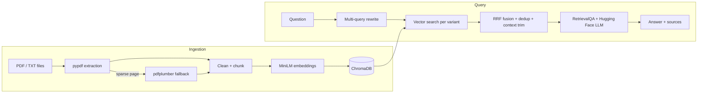

# rag-document-chatbot
# RAG Chatbot

A retrieval-augmented generation (RAG) chatbot that answers questions over your own documents. It runs fully locally: PDFs are parsed, chunked, embedded with MiniLM, stored in ChromaDB, and queried through a LangChain `RetrievalQA` chain backed by a Hugging Face model. The whole thing is served as a FastAPI REST service and ships with a Dockerfile for reproducible local inference.

Built and exercised on a corpus of 750+ PDF pages.

## Features

- **Robust PDF ingestion** - `pypdf` for speed, with a per-page `pdfplumber` fallback when a page yields little or no text. Pages that remain empty are reported as warnings and skipped; scanned pages may require OCR.
- **Chunking with LangChain** - recursive splitting with configurable size and overlap; page and source metadata are kept on every chunk. Source paths are relative to the data directory, so identically named files in different folders remain distinct.
- **MiniLM embeddings + ChromaDB** - `all-MiniLM-L6-v2` embeddings (normalized, cosine space) in a persistent Chroma collection. Ingestion uses source/page/content IDs and removes stale chunks after successfully adding the current corpus.
- **Better retrieval accuracy**
  - *Multi-query retrieval*: the question is rewritten into several variants (LLM paraphrases plus a keyword-only variant).
  - *Rank fusion*: results from all variants are merged with Reciprocal Rank Fusion.
  - *De-duplication*: exact and near-duplicate chunks from the same source page are removed (token-set Jaccard), while identical text from other pages keeps its own citation.
  - *Context tuning*: only the top-k chunks are kept and trimmed to a character budget so the prompt fits the model.
- **RetrievalQA (Hugging Face)** - local `google/flan-t5-base` by default; swap in any Hugging Face text2text or text-generation model through an environment variable.
- **FastAPI endpoint** - `/ask` returns the answer together with its source documents and pages; `/health` reports index status.
- **Docker** - CPU-only image, with volumes for documents, the vector store and the model cache.

## Architecture



## Project structure

```
.
├── app/
│   ├── config.py        # environment-driven settings
│   ├── ingest.py        # PDF loading, fallback, chunking, indexing (CLI)
│   ├── vectorstore.py   # MiniLM embeddings + ChromaDB
│   ├── retriever.py     # multi-query retriever, fusion, dedup, context budget
│   ├── qa.py            # RetrievalQA chain and RAGService
│   ├── schemas.py       # request/response models
│   ├── main.py          # FastAPI app
│   └── utils.py         # text cleaning, dedup, RRF, trimming helpers
├── tests/               # unit tests for the retrieval helpers
├── data/                # put your documents here (git-ignored)
├── Dockerfile
├── docker-compose.yml
├── requirements.txt
└── .env.example
```

## Quick start (local)

Requires Python 3.10+.

```bash
git clone https://github.com/<your-username>/rag-chatbot.git
cd rag-chatbot

python -m venv .venv
source .venv/bin/activate        # Windows: .venv\Scripts\activate
pip install -r requirements.txt

cp .env.example .env             # optional: tweak settings
```

1. Put your PDFs (or `.txt` / `.md` files) in `data/`.
2. Build the index:

   ```bash
   python -m app.ingest --data-dir data --reset
   ```

3. Start the API:

   ```bash
   uvicorn app.main:app --reload
   ```

   Interactive docs are available at <http://localhost:8000/docs>.

The first run downloads the embedding and LLM weights from Hugging Face; later runs use the local cache.

After upgrading an existing index, rebuild it once with `--reset` so stored IDs and source metadata use relative paths for nested files.

## Quick start (Docker)

```bash
# 1. Add documents to ./data
# 2. Build the image
docker compose build

# 3. Index the documents (stored in a named volume)
docker compose run --rm api python -m app.ingest --data-dir /app/data --reset

# 4. Start the API
docker compose up
```

To bake the models into the image so the container can start offline:

```bash
docker build --build-arg PRELOAD_MODELS=1 -t rag-chatbot:latest .
```

## API

### `POST /ask`

```bash
curl -X POST http://localhost:8000/ask \
  -H "Content-Type: application/json" \
  -d '{"question": "What does the document say about data retention?", "top_k": 4}'
```

```json
{
  "answer": "...",
  "sources": [
    { "source": "handbook.pdf", "page": 42, "snippet": "..." }
  ]
}
```

| Field      | Type | Description                                         |
|------------|------|-----------------------------------------------------|
| `question` | str  | The user question (3-1000 characters)               |
| `top_k`    | int  | Optional. Chunks used as context (1-10, default 4)  |

If the index is empty, the endpoint returns `503` with a message to run ingestion first.

### `GET /health`

Returns `{"status": "ok", "indexed_chunks": <int>}`.

## Configuration

All settings are environment variables (see [`.env.example`](.env.example)).

| Variable             | Default                                  | Description                                   |
|----------------------|------------------------------------------|-----------------------------------------------|
| `EMBEDDING_MODEL`    | `sentence-transformers/all-MiniLM-L6-v2` | Embedding model                               |
| `LLM_MODEL`          | `google/flan-t5-base`                    | Hugging Face generation model                 |
| `LLM_TASK`           | `text2text-generation`                   | Use `text-generation` for decoder-only models |
| `MAX_NEW_TOKENS`     | `256`                                    | Max generated tokens                          |
| `DEVICE`             | `-1`                                     | `-1` for CPU, `0` for the first GPU           |
| `CHUNK_SIZE`         | `800`                                    | Characters per chunk                          |
| `CHUNK_OVERLAP`      | `150`                                    | Overlap between chunks                        |
| `MIN_PAGE_CHARS`     | `40`                                     | Below this, a page triggers the pdfplumber fallback |
| `TOP_K`              | `4`                                      | Chunks passed to the LLM                      |
| `FETCH_K`            | `8`                                      | Candidates fetched per query variant          |
| `NUM_QUERY_VARIANTS` | `3`                                      | LLM rewrites per question (0 disables)        |
| `DEDUP_THRESHOLD`    | `0.85`                                   | Jaccard similarity above which chunks are duplicates |
| `MAX_CONTEXT_CHARS`  | `2400`                                   | Context budget sent to the LLM                |

## How retrieval works

1. **Query expansion** - the LLM rewrites the question into a few paraphrases; a stopword-stripped keyword query is added as well. If rewriting fails, retrieval falls back to the original question.
2. **Parallel search** - each variant is searched against ChromaDB (`FETCH_K` results each).
3. **Reciprocal Rank Fusion** - chunks that rank well across several variants are promoted.
4. **De-duplication** - overlapping chunks (common with sliding-window chunking and repeated headers/footers) are removed.
5. **Context tuning** - the top `TOP_K` chunks are trimmed to `MAX_CONTEXT_CHARS`, which matters for small models with short input windows.
6. **Generation** - the `stuff` chain fills a strict prompt that tells the model to answer only from the context or say it does not know.

## Tuning tips

- Answers miss details: raise `TOP_K` and `MAX_CONTEXT_CHARS` (and use a model with a longer context window).
- Irrelevant or repetitive context: lower `DEDUP_THRESHOLD` or `CHUNK_OVERLAP`.
- Slow responses: set `NUM_QUERY_VARIANTS=0` to skip LLM query rewriting.
- Better answer quality: try a larger instruction-tuned model, e.g. `LLM_MODEL=google/flan-t5-large`.

## Testing

```bash
pip install -r requirements-dev.txt
pytest -q
```

The unit tests cover the retrieval helpers (cleaning, de-duplication, rank fusion, context trimming and query parsing) and need no model downloads.

## Limitations

- Scanned PDFs with no text layer need OCR first; neither extractor performs OCR.
- Small local models can produce short or imperfect answers; answer quality depends heavily on the chosen model.
- Chunks are split per page, so a passage that spans a page break is indexed as two chunks.
- There is no authentication or rate limiting on the API; add them before exposing it publicly.

## Roadmap

- Cross-encoder re-ranking
- Streaming responses
- Conversation memory
- OCR support for scanned documents
- Retrieval quality evaluation suite

## License

Released under the [MIT License](LICENSE).
